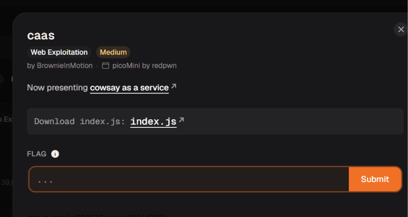

# caas

Bài này có cấp cho mình 1 file mã nguồn index.js có vẻ là 1 bài dạng whitebox

 Giao diện trang chủ hướng dẫn cách sử dụng dịch vụ bằng cách truy cập URL theo cấu trúc `.../cowsay/{message}`

File `index.js` sử dụng hàm `exec` nối trực tiếp biến `req.params.message` vào lệnh shell `/usr/games/cowsay` mà không hề lọc dữ liệu, dẫn đến lỗ hổng Command Injection. 

Mã nguồn thực thi lệnh qua hàm `exec`, lấy toàn bộ kết quả đầu ra (`stdout`) và gửi trực tiếp về trình duyệt dưới định dạng văn bản thuần túy thông qua `res.type('txt')`
Biến `req.params.message`  là nơi dữ liệu chúng ta nhập sau đường dẫn https://caas.mars.cylabacademy.net/cowsay/

Vậy sẽ ra sao nếu mình kéo dài thêm lệnh để hàm exec không chỉ thực hiện chạy mỗi chương trình 

`/usr/games/cowsay`  mà còn chạy thêm lệnh mình thêm vào nữa 

`${req.params.message} = hello,ls`

 →`exec(`/usr/games/cowsay hello,ls``

Lệnh của mình đã được thực hiện và in ra toàn bộ thư mục hiện tại  và mình thấy có file khá giống flag là falg.txt

picoCTF{moooooooooooooooooooooooooooooooooooooooooooooooooooooooooooo0o}