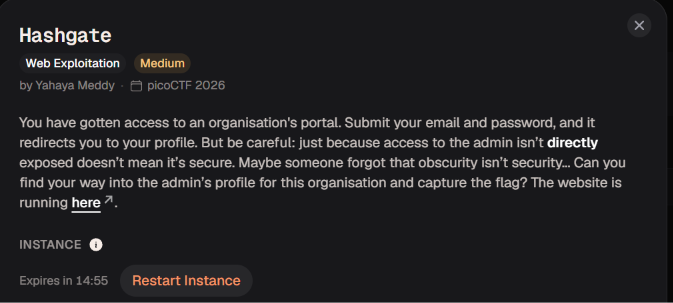

# Hashgate



Bài này yêu cầu chúng ta phải truy cập được vào profile của admin 


Trong mã HTML mình thấy có 1 comment có vẻ như là 1 tài khoản nền mình sẽ lấy đăng nhập thử xem


Nó chuyển hướng mình đến enpoint `/profile/user/e93028bdc1aacdfb3687181f2031765d`


Ở đây nó yêu cầu mình phải truy cập vào người dùng quyền cao hơn mới xem được flag

Đoạn cuối của endpoint profile là một chuỗi gồm 32 ký tự hexadecimal, khá giống định dạng của MD5. Vì vậy, mình thử tra cứu giá trị hash này để xem có tìm được dữ liệu đầu vào hay không

```jsx
/profile/user/<hash>
```


Kết quả tra cứu là `3000`, trùng với User ID của tài khoản Guest. Như vậy, mình xác định được rằng ứng dụng sử dụng MD5 của User ID để tạo đường dẫn profile.

Sau đó mình thử dùng 1 id khác và md5 nó và thử truy cập vào profile của id đó xem 


Kết quả trả về `404 User not found`. Điều này khiến mình nghi ngờ rằng server đang sử dụng giá trị MD5 trong URL để tra cứu người dùng. Nếu server không kiểm tra quyền truy cập, có thể mình sẽ xem được profile của người dùng khác bằng cách thay đổi giá trị hash này.

Nhưng giờ mình không biết có những User ID nào nên mình sẽ thử tính md5 của các id từ 0-5000 và truy cập và profile của các id đó 

```jsx
import hashlib
with open("hashes.txt", "w", encoding="utf-8") as f:
    for i in range(0, 5001):
        res = hashlib.md5(str(i).encode()).hexdigest()
        f.write(res + "\n")
print("ok")
```

```jsx
➜  Downloads python3 1.py
ok
➜  Downloads 
```

Sau khi có file chứ các md5 rồi thì mình sẽ vào burpsuite và gửi endpoit `/profile/user/e93028bdc1aacdfb3687181f2031765d` đến tab `Intruder` để tiến hành `brutce force`


Mọi người hãy tô đen phần `hash` và nhấn `Add $` , bên phải chỗ Payloads thì mọi người hãy chọn `Load…` và tải file mình vừa tạo lên rồi bắt đầu `Start attack` 


Sau khi có kết quả mọi người chọn vào filter để bỏ các đoạn mã 4xx và 5xx đi cho đỡ rối


Đến đây mình lấy được flag trong endpoint `/profile/user/22722a343513ed45f14905eb07621686`

academy{id0r_unl0ck_cbbb8f45}