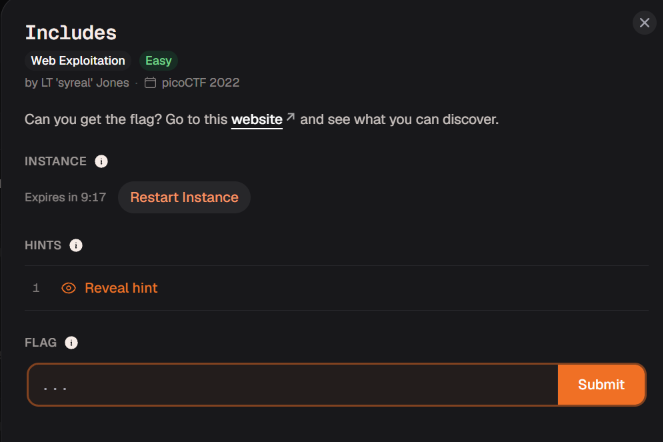

# Includes

Bản chất & Ví dụ: - Include: HTML có thể gọi file ngoài bằng <script src=...> hoặc <link href=...>.- Static assets: File tĩnh vẫn là dữ liệu server trả về, có thể chứa comment hoặc path.- Network: Tab Network cho thấy browser tải những file nào, kể cả file không hiện rõ trên UI.
Hệ sinh thái kiến thức: - HTML include- Static assets- CSS/JS path- DevTools Network- Source linking
Trạng thái: Hoàn tất
Trạng thái 1: Chưa bắt đầu

Đây là 1 bài web easy của pico 

Sau khi truy cập link, trang web hiển thị nội dung cơ bản kèm nút "Say hello". Khi bấm vào nút này, một thông báo hiện ra báo rằng "This code is in a separate file!" (Mã này nằm ở một file riêng)

Từ thông báo "separate file" (file riêng biệt), mình đoán tác giả muốn hướng chúng ta tìm cờ ở các file được liên kết/đính kèm với web.

Trong mã nguồn, trang web có đính kèm (nhúng) 2 file bên ngoài là `style.css` và `script.js`

Sau khi click vào link đến với 2 file thì :

Trong file CSS có chứa một dòng chú thích ẩn nửa đầu của flag: `academy{1nclu51v17y_1of2_`.   

Trong file JS có chứa một dòng chú thích ẩn nửa sau của flag: `f7w_2of2_254cc2a8}`.

Flag: `academy{1nclu51v17y_1of2_f7w_2of2_254cc2a8}`