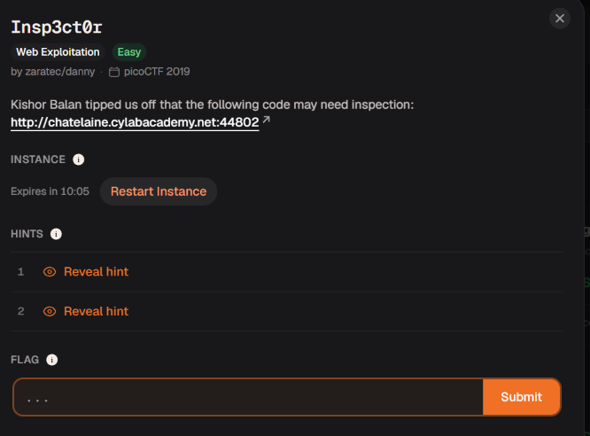

# Insp3ct0r

Bản chất & Ví dụ: - HTML/CSS/JS: Web client thường tách nội dung, giao diện, logic thành nhiều file.- CSS: Không chỉ làm đẹp; comment CSS cũng có thể chứa dữ liệu.- JavaScript: File JS có thể chứa logic kiểm tra hoặc chuỗi bị giấu.- Asset inspection: Không chỉ xem trang chính; cần mở cả file .css, .js, image, route phụ.
Hệ sinh thái kiến thức: - HTML- CSS- JavaScript- DevTools Sources- Asset inspection
Trạng thái: Hoàn tất
Trạng thái 1: Chưa bắt đầu

Một bài web dễ từ cylab và đề bài cung cấp gợi ý từ khóa "inspection" 

Mình thấy giao diện trang web mục tiêu có tiêu đề "Inspect Me". Chuyển sang tab "How", web gợi ý rằng nó được tạo ra bằng HTML, CSS và JS. Vì bài nhắc khá nhiều đến inspect có vẻ như là nó muốn gợi mình dùng 1 chức năng của web là devtool(F12)
 Mình sẽ nhấn `F12` (hoặc Chuột phải -> Inspect) để mở Developer Tools và kiểm tra mã nguồn của trang web.

Mình dùng DevTools mở tab `Sources`, kiểm tra mã nguồn file `(index)` (HTML) và thấy phần 1 của flag nằm ở dòng 31 dưới dạng comment: `academy{tru3_d3` . Lúc đầu mình được nhắc đến web được làm bằng 3 ngôn ngữ và giờ ta thấy flag được 1 phần trong html nến giờ mình sẽ tìm ở 2 ngôn ngữ còn lại.

Mình mở file `mycss.css` và cuộn xuống dòng 51, thấy phần 2 của flag nằm trong chú thích: `t3ct1ve_0r_ju5t`.   Mình sẽ mở tiếp file `myjs.js` trong cây thư mục để tìm phần thứ 3 của flag.

Mình mở file `myjs.js`, xem ở dòng 21 và tìm thấy phần 3 của flag nằm trong chú thích: `_lucky?ced8b407}`

Flag hoàn chỉnh: `academy{tru3_d3t3ct1ve_0r_ju5t_lucky?ced8b407}`