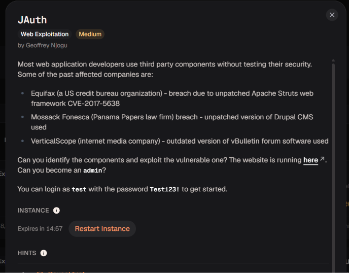

# JAuth

Bản chất & Ví dụ: - JWT: Token gồm header, payload, signature, ngăn bằng dấu ..- Claim: Dữ liệu như user, role, admin nằm trong payload.- Signature: Bảo vệ payload khỏi bị sửa nếu secret/key đủ mạnh và verify đúng.
Hệ sinh thái kiến thức: - JWT- Header/payload/signature- Claim- Base64URL- Token trust
Trạng thái: Chưa bắt đầu
Trạng thái 1: Chưa bắt đầu

Đây là 1 bài web liên quan đến việc khai thác các thành phần bên thứ ba chưa được vá lỗi

Sau khi đăng nhập bằng tài khoản mà tác giả cung cấp server trả về mã `302 Found` kèm cookie chứa token (`token=eyJ0eXAi...`) và chuyển hướng sang `/private`

Mình giải mã token thấy JWT với thuật toán sử dụng là `HS256` và trong phần Payload có trường `"role": "user"`

`Keep-Alive: timeout=5` (đặc trưng của Node.js) và mã nguồn HTML nạp thư viện `bootswatch/3.2.0/united/bootstrap.min.css` (phát hành giai đoạn 2014–2015)

Vì đề bài đã khá nhấn mạnh về việc lỗi ở phần mềm bên thứ ba nên mình sẽ tìm sâu hơn về lỗ hổng liên quan đến jwt và thư viện trong khoảng thời gian 2014-2015

Mình tra cứu từ khóa `JWT library vulnerability 2014-2015` và xác định được lỗ hổng **CVE-2015-9235** trên module `jsonwebtoken` của Node.js (bản trước `4.2.2`), cho phép kẻ tấn công vượt qua bước xác thực chữ ký thông qua lỗi `alg: none`

Sau đó mình sẽ tiến hành chỉnh sửa phần Header của JWT thành `"alg": "none"`, nâng quyền trong Payload lên `"role": "admin"` và xóa bỏ phần chữ ký (Signature) để tạo token giả mạo

Mình thay thế chuỗi JWT đã giả mạo (`alg: none`, `role: admin` và kết thúc bằng dấu `.` không chữ ký) vào `Cookie: token=...` tại request `GET /private`.  và mình đã lấy được flag

`academy{succ3ss_@u7h3nt1c@710n_99bf4b72}`