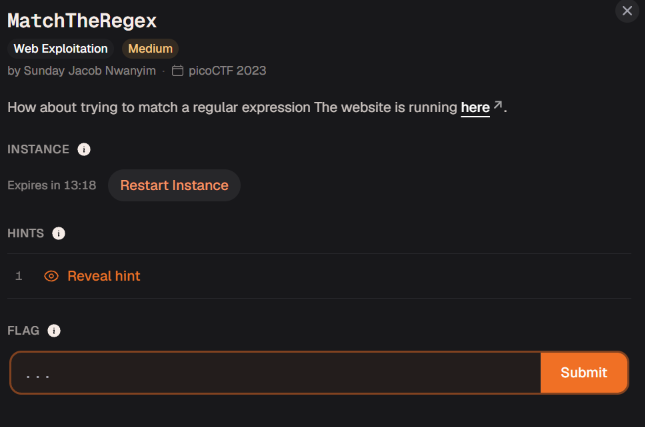

# MatchTheRegex

Đây là bài medium trên picoctf, đề bài có gợi ý cho chúng ta về liên quan đến dùng các biểu thức chính quy

**Một số ký hiệu cơ bản trong Regex:**

- `.` : Đại diện cho *một* ký tự bất kỳ.
- : Đại diện cho ký tự đứng trước nó lặp lại *0 hoặc nhiều lần*.
- `^` : Bắt đầu của một chuỗi.
- `$` : Kết thúc của một chuỗi.
- `[a-z]` : Chữ cái viết thường từ a đến z.
- `\d` : Bất kỳ chữ số nào (từ 0 đến 9).

Mình nhập thử input nào đó

Mình thấy ứng dụng gửi GET request tới endpoint `/flag` với tham số `input=ad`, và nhận về JSON báo lỗi `{"flag":"wrong match! Try again!"}` , mình nghĩ chắc input này của chúng ta sẽ được so xem có khớp với flag hay không 

Như mọi người đã biết thì flag sẽ có phần đầu cố định là `academy` nên mình sẽ thử truyền vào giá trị input xem sao 

Flag: academy{succ3ssfully_matchtheregex_2df06a95}