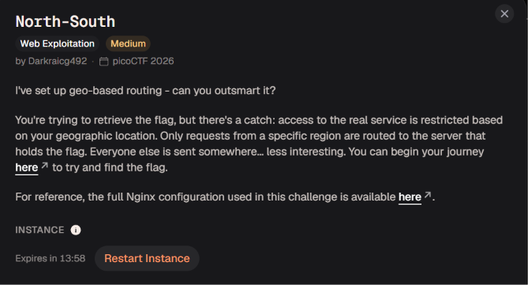

# North-South



Bài này là 1 bài liên quan đến định tuyến theo vị trí địa lý 


Đầu tiên thì mình truy cập trang web và nó thống báo vị trí  hiện tại của mình thì sẽ không có flag tiếp mình sẽ đọc file cấu hình Nginx mà bài cung cấp

```jsx
geoip2 /etc/nginx/GeoLite2-Country.mmdb {
        auto_reload 5m;
        $geoip2_data_country_code default=ZZ country iso_code;
    }
```

Trong đoạn mã này Nginx dùng GeoIP2 để tra cứu IP client trong cơ sở dữ liệu `GeoLite2-Country.mmdb`

```jsx
$geoip2_data_country_code default=ZZ country iso_code;
```

`$geoip2_data_country_code` Biến Nginx lưu mã quốc gia tìm được và giá trị mặc định nếu không tìm được là `ZZ` ,nếu có thì sẽ lấy `iso_code` trong trường `country` của dữ liệu

```jsx
server {
        listen 80;

        location / {
            if ($geoip2_data_country_code = IS) {
                proxy_pass http://south;
            }

            proxy_pass http://north;
        }
    }
```

Đoạn này là sẽ kiểm tra xem mã code quốc gia chúng ta tìm được có phải là `IS` hay không

Nếu đúng sẽ chuyển đến `backend south`, ngược lại là `backend north` 

Như lúc đầu mình không dùng IP của quốc gia IS nên có vẻ như  request mình đã bị chuyển tiếp đến `backend north`, vậy giờ để có được flag thì có vẻ chúng ta sẽ phải thay đổi thành 1 IP có mã là quốc gia `IS` để chúng ta có thể truy cập vào `backend south` 

Ở đây, `north` và `south` là hai upstream được khai báo trong cấu hình Nginx, lần lượt trỏ đến `127.0.0.1:8000` và `127.0.0.1:9000`.

Điểm đáng chú ý là Nginx sử dụng module GeoIP2 để xác định quốc gia dựa trên IP của client, thay vì dựa trực tiếp vào vị trí GPS trên thiết bị.

Ban đầu, mình nghĩ đến việc sử dụng header `X-Forwarded-For` để thay đổi IP được nhận diện. Tuy nhiên, trong cấu hình được cung cấp không có thiết lập yêu cầu GeoIP2 lấy IP từ header này nên là mình đã không thành công theo hướng này. Vì vậy, mình chuyển sang thử nghiệm với VPN để request thực sự đi ra Internet bằng một địa chỉ IP được nhận diện thuộc Iceland.


Ở đây thì mình dùng urban vpn để chuyển sang ip của Iceland sau đó thì mình sẽ kiểm tra lại xem với ip này thì mã quốc gia hiện tại của mình bây giờ là gì nhé

[*https://api.country.is/*](https://api.country.is/)

Mọi người truy cập link này thì sẽ xem được mã quốc gia hiện giờ ứng với ip của mình nhé


Mã quốc gia mình bây giờ đã là `IS` rồi giờ mình sẽ truy cập lại vào link thử thách xem thế nào


Đã có được flag rồi nhé

`academy{g30_b453d_r0u71n9_21e6aeab}`