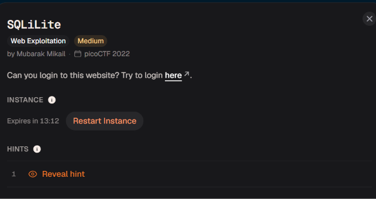

# SQLiLite

Bản chất & Ví dụ: - SQL injection: Input bị nối trực tiếp vào query làm thay đổi ý nghĩa SQL.- Login query: Dạng phổ biến là WHERE user='...' AND pass='...'.- SQLite: DB nhẹ, cú pháp có khác MySQL/PostgreSQL nhưng SQLi core giống nhau.
Hệ sinh thái kiến thức: - SQL injection cơ bản- Login query- SQLite- Comment SQL- Boolean bypass
Trạng thái: Chưa bắt đầu
Trạng thái 1: Chưa bắt đầu

Đầu tiên thì trang web sẽ yêu cầu chúng ta phải đăng nhập, ở đây thì mình sẽ nhập thử 1 cái tài khoản vào

Sau khi mình nhập 1 cái tài khoản nào đó thì web đã làm lộ luôn câu truy vấn mà nó sẽ gọi về phía backend để lấy dữ liệu

Việc nối chuỗi input thẳng vào câu truy vấn chứng tỏ backend không sử dụng cơ chế bảo vệ hay là lọc dữ liệu gì cả mà đẩy thẳng dữ liệu chúng ta nhập và truy vấn và gọi luôn, và giờ để đăng nhập thành công thì mình sẽ nối thêm input vào để khiến cho câu query này luôn đúng và chúng ta có thể đăng nhập web 

Ở đây mình đã đăng nhập thành công nhưng lại không thấy flag mà rõ ràng có dòng chữ bảo flag ở ngay trước mắt nên mình đoán có vẻ là nó được viết đặt vào trông mã nguồn của trang 

Mình mở source page và lấy flag

academy{L00k5_l1k3_y0u_solv3d_it_8fcb45de}