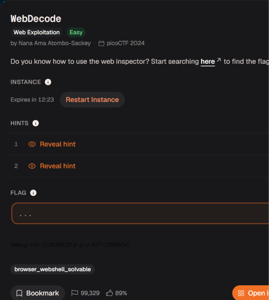

# WebDecode

Bài web này có vẻ liên quan đến chức năng inspector của web 

Mình xem trong source thì ko có gì chỉ có 2 trang html này là chưa thấy được có gì thôi nên mình sẽ truy cập lần lượt vào cả 2 trang

Khi mình truy cập /contact.html  thì nó chỉ hiện dòng chữ yêu cầu chúng ta tiếp tục tìm trên trang này

Xem sorce page cũng không có gì cả chỉ còn mỗi `about.html` mà chúng ta chưa truy cập thôi

Khi truy cập vào `/about.html` thì nó yêu cầu mình kiểm tra page này và sẽ có thể tìm được gì đó 

Ở đây sau khi vào source page thì mình thấy có chuỗi base64 khá khả nghi nên sẽ đem đi decode

Sau khi decode thì mình lấy được flag 

academy{web_succ3ssfully_d3c0ded_07989b25}