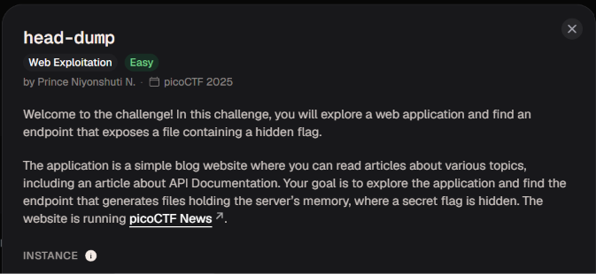

# head-dump

Bản chất & Ví dụ: - Debug endpoint: Route phục vụ dev nếu lộ public có thể leak dữ liệu.- Heap dump: Snapshot memory ứng dụng, có thể chứa token/secret/string nhạy cảm.- Sensitive exposure: Lỗi không phải injection mà là lộ thông tin do config sai.
Hệ sinh thái kiến thức: - API documentation- Debug endpoint- Heap dump- Sensitive data exposure- Backend introspection
Trạng thái: Chưa bắt đầu
Trạng thái 1: Chưa bắt đầu
Tên bài / Chủ đề: head-dump

Đề bài cho biết trang blog **picoCTF News** có bài viết về **API Documentation** và yêu cầu tìm endpoint xuất file chứa bộ nhớ của server (nơi giấu flag). 

Trên trang chủ blog, mình thấy bài đăng *"Explore backend development with us"* có gắn kèm hashtag  và đường dẫn `#API Documentation`.   Mình nhấn vào đường dẫn `#API Documentation` để mở trang tài liệu API của web.  

Sau khi mở trang tài liệu mình thấy ở mục **Diagnosing** có endpoint `GET /heapdump` (*Diagnosing the memory allocation*).   Mình nhấn mở endpoint `GET /heapdump` để tiến hành gọi API .   

Gửi request `GET /heapdump` trên Burp Suite và tìm kiếm trong khung Response, mình thấy xuất hiện flag `academy{Pat!3nt_15_Th3_K3y_abc961cc}`