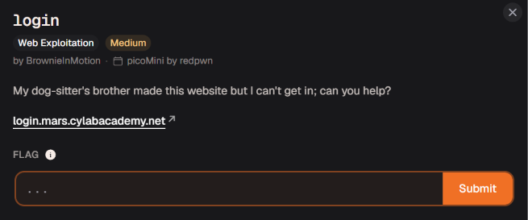

# login




Bài này yêu cầu chúng ta phải đăng nhập vào trang web, đọc miêu tả cũng thấy hướng gì mình sẽ mở thử burp lên xem có gì không 


Ở đây mình thấy trong file `index.js` có logic xác thực 

```jsx
(async () => {
    await new Promise((e => window.addEventListener("load", e))),
    document.querySelector("form").addEventListener("submit", (e => {
        e.preventDefault();
        const r = {
            u: "input[name=username]",
            p: "input[name=password]"
        },
        t = {};
        for (const e in r)
            t[e] = btoa(document.querySelector(r[e]).value).replace(/=/g, "");
        return "YWRtaW4" !== t.u
            ? alert("Incorrect Username")
            : "cGljb0NURns1M3J2M3JfNTNydjNyXzUzcnYzcl81M3J2M3JfNTNydjNyfQ" !== t.p
                ? alert("Incorrect Password")
                : void alert(`Correct Password! Your flag is ${atob(t.p)}.`);
    }))
})();
```

Hiểu nhanh code thì là nó sẽ lấy `username` và `password` mà chúng ta nhập rồi mã hóa `base64` bằng hàm `btoa(…..)` sau đó thì sẽ so sánh 

```jsx
base64 của username ≠ "YWRtaW4"
```

Nếu sai thì in ra `"Incorrect Username"`, ngược lại sẽ so sánh password

```jsx
base64 của password ≠ "cGljb0NURns1M3J2M3JfNTNydjNyXzUzcnYzcl81M3J2M3JfNTNydjNyfQ"
```

Nếu khác thì in ra `"Incorrect Password"`, ngược lại sẽ in ra flag 

Ở đây giờ mình sẽ giải mã 2 chuỗi base64 xem nó là gì và chúng ta đăng nhập thôi 

```jsx
➜  Admin echo "YWRtaW4" | base64 -d                                 
admin%                                                                                                                                                                                                      
➜  Admin echo "cGljb0NURns1M3J2M3JfNTNydjNyXzUzcnYzcl81M3J2M3JfNTNydjNyfQ" | base64 -d
picoCTF{53rv3r_53rv3r_53rv3r_53rv3r_53rv3r}%                                                                                                                                                                
➜  Admin
```


Flag chính là mật khẩu luôn 

picoCTF{53rv3r_53rv3r_53rv3r_53rv3r_53rv3r}